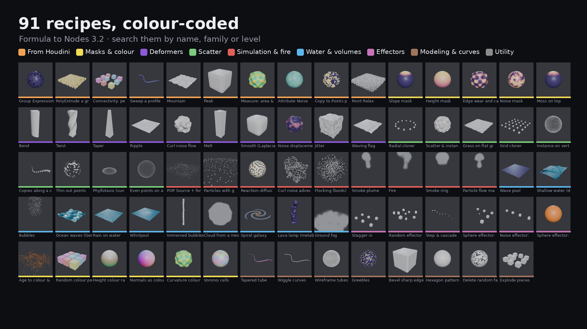

# Formula to Nodes — listing description (v3.2)

## Stop wiring Math nodes by hand.

`sin(r) * amp` is six nodes and eight connections in Geometry Nodes. A real effect is thirty.
Type the formula instead and get the group.

```
float r = length(v@P)
@P.z = sin(r * freq) * amp
```

Two lines. `freq` and `amp` appear as sliders automatically. What you get is an ordinary,
editable node group — open it, rewire it, learn from it. Nothing is baked or hidden.

The syntax is VEX-flavoured, so a Houdini wrangle translates directly. If you've never
written one, it reads like the formula you'd write on paper.

## Never used it? Start here

1. Install the zip: *Edit → Preferences → Get Extensions → ⌄ → Install from Disk*.
2. Select any mesh, open the 3D Viewport sidebar (**N**) and pick the **Formula** tab.
3. Click **Twist** under *Start here*. Change it with the sliders in the Modifier tab.

Search the 91 recipes in plain words (*rock*, *trees*, *water*, *fire*), filter by colour-coded
category or by level (easy / medium / advanced), and click **+** to add one to the selected
object. Step-by-step cards are in [`promo/guide_cards`](promo/guide_cards).



## What it does

- **Single-line formulas** or **multi-line scripts** with typed local variables, edited in the
  panel or the Text Editor. Writes chain top to bottom, like a wrangle.
- **Branching** — `if / else if / else`, ternaries `? :`, comparisons, `&& || !`.
- **Zones** — `simulate { }` for anything that accumulates over time (`deltatime` included),
  `repeat(n) { }`, and `foreach(face) { }` across point, edge, face, curve and instance domains.
- **Parameters** — `chf("amp", 0.5, min=0)`, plus `chi` / `chv` / `chb`, become real inputs on
  the node with defaults and ranges.
- **99 functions** — trig, exp, log, atan2, noise, random, clamp, lerp, smoothstep, fit,
  rotate, reflect, project, refract, and the rest.
- **Reads and writes real geometry** — `@P`, `@N`, `@id`, `@pscale`, `@ptnum`, `@Time`,
  tangent, curve parameter, each through its correct dedicated node. Writing `@N`, `@id` and
  `@pscale` is supported, not faked.
- **Rebuild in place** — regenerating keeps the group's name, its links and your modifier
  values. *Edit Selected Group* loads a group's script back into the panel.
- **Tidy output** — constants are folded, repeated sub-expressions are shared, and the graph is
  laid out left to right with zones respected.
- **Check before you build** — errors come back with line numbers and the bad line highlighted.

## Live Viewer — see the node while you type

A node-shaped card in the Geometry Node Editor shows what your script becomes, live: its
outputs, every input with its default (grouped by panel), the node count — or the error, with the
offending line. Below it, **live values**: min / average / max of every attribute the script
writes, read from the active object at the current frame, plus NaN/inf warnings. Toggle it with
**Viewer** / **Values** in the sidebar.

**Open in Text Editor** puts a real code editor next to the nodes; the viewer follows your typing
and **Ctrl+Enter** builds. Building while you're inside a Formula group updates that group in
place. Before a rebuild could lose work — a different script going into the selected group, nodes
you edited by hand, links that would be cut — it asks first. Every script you replace (loading a
recipe, pasting, AI Assist) is kept in a *Formula Recovery* text. **Save as Preset** keeps your
own scripts under *Recipes › My Presets* in every file.

## Coming from Houdini

Tested with Houdini artists. Unprefixed attributes are floats like in VEX; `@age @life @dead
@force @TimeInc` keep their POP meanings; groups are bool attributes (`@group_top`,
`inpointgroup`, `setprimgroup`); `@curveu` and `@class` map to Blender's equivalents; `$F` and
Y-up gravity get a friendly note; `instance()` aligns +Z to `@N` and +Y to `v@up` like Copy to
Points; easing functions are built in. A **From Houdini** recipe column covers Attribute
Transfer, Group Expression, PolyExtrude, Connectivity, Sweep with a profile, Mountain, Peak,
Measure, Attribute Noise, Copy to Points prep and Point Relax — named so you can find them.

## AI Assist

Describe the effect; the add-on writes the script. Every reply is compiled first, and compile
errors are sent back to the model to fix, so what lands in your panel already builds. Works
with Claude, OpenAI, Ollama or any OpenAI-compatible server. No API key? **Copy Prompt for Any
Chatbot** gives you the whole language guide to paste anywhere — paste the reply back and the
code fences are stripped for you.

## Claude Desktop & Claude Code (MCP)

With Blender Lab's **MCP** add-on running, one button in the sidebar connects Claude Desktop.
Ask for an effect in plain language and it builds the nodes in your open file, then reads the
evaluated result back to check its own work. It runs on Blender's bundled Python — nothing
else to install.

*Sidebar → Formula → Claude Desktop (MCP) → Connect Claude Desktop, then restart Claude.*

## New in 2.1

A full rewrite with a real compiler. Ten cases that silently produced **wrong geometry** in
1.0.x are fixed — including vector math collapsing to a scalar in nested expressions,
`v ** 2`, `abs()` on vectors, `log(x)`, and locals losing their value after a later write.
Groups are also smaller: the same legacy scripts now build with fewer nodes.

Blender 5.2 · GPL-3.0-or-later · pure Python, no bundled binaries
